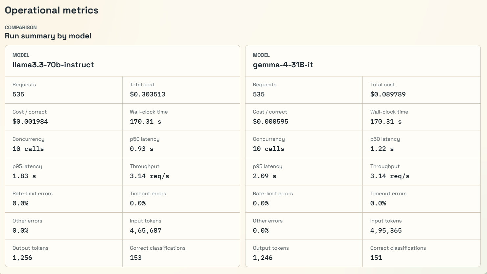
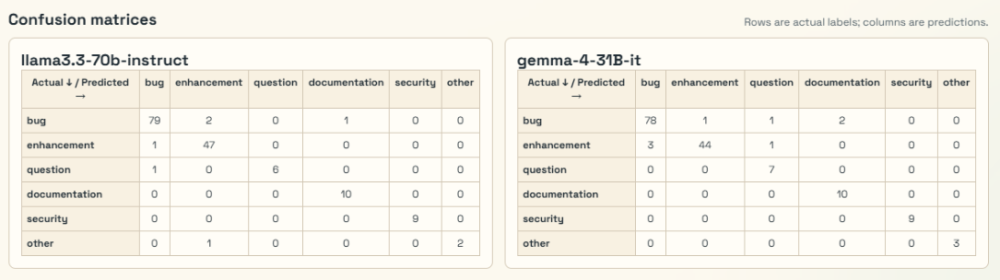
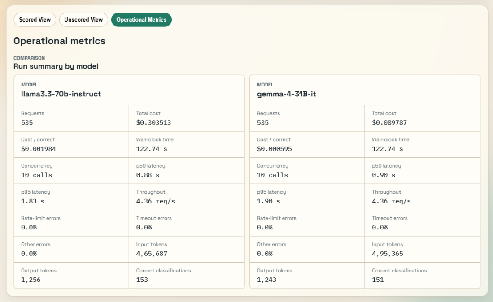

# Cost-Effective LLM Selection for doctel GitHub Issue Triage

> **Live application:** [https://digital-ocean-assignment.onrender.com/]
>

## Recommendation

Use **gemma-4-31B-it** as the production default, with **llama3.3-70b-instruct** as a quality-first fallback for uncertain cases, particularly likely `bug` and `enhancement` issues. Gemma achieved **95.0% accuracy** at **70.0% lower cost per correct classification** than Llama, while remaining within **1.2 percentage points** of Llama's 96.2% accuracy.

## Scenario

The customer currently uses expensive frontier models to classify incoming product issues. This project uses issues from `digitalocean/doctl` as a representative proving ground to determine whether smaller, less expensive models can preserve useful classification quality. The goal is not merely to identify the highest-scoring model on one repository, but to produce a cost-aware recommendation and evaluation approach that can extend to a broader multi-repository support workload.

## Ground Truth Methodology

### Labeling Inputs

Ground-truth decisions use only the issue **title and body**, matching the information available to the model at inference time. Comments, events, maintainer discussion, and eventual resolution are excluded to prevent future-information leakage.

### Category Priority

When an issue plausibly belongs to more than one class, apply this priority order:

```text
security > bug > documentation > enhancement > question > other
```

Rationale for each precedence decision:

- `security` takes priority because security-sensitive reports require distinct handling even when they also describe a defect.
- `bug` takes priority over documentation or enhancement when the issue reports behavior that contradicts the intended product behavior.
- `documentation` takes priority when the requested correction concerns existing user-facing documentation rather than product behavior.
- `enhancement` covers requested product behavior that does not already exist.
- `question` applies when the issue primarily requests explanation or guidance.
- `other` is reserved for issues that do not fit the preceding operational categories.

### Intent as Filed

Label the issue according to the reporter's intent at filing time, not according to its eventual maintainer resolution. For example, an issue filed as a monitoring question remains `question` even if maintainers later discover or implement a product change.

### Documentation vs. Enhancement

Use the following boundary:

- Choose `documentation` when the requested change corrects or clarifies existing documentation, including generated man pages.
- Choose `enhancement` when the issue requests new product behavior, flags, commands, or workflow changes.

### Review Process

Labels were generated with LLM assistance and then human-reviewed. The LLM accelerated initial categorization; the human review applied the priority rule, resolved ambiguous boundaries, and checked that labels represented intent as filed.

### Golden-Set Composition

The golden dataset contains **159 human-reviewed issues**.

| Class | Count | Share |
|---|---:|---:|
| Bug | 82 | 51.6% |
| Enhancement | 48 | 30.2% |
| Question | 7 | 4.4% |
| Documentation | 10 | 6.3% |
| Security | 9 | 5.7% |
| Other | 3 | 1.9% |
| **Total** | **159** | **100%** |

Results for `security` and especially `other` should be interpreted cautiously because their support is small. The security subset also contains substantial CVE-bot noise, so its measured performance may not generalize to manually reported security issues.

### Maintainer-Label Coverage

Maintainer labels covered **93.6% of open issues** but only **56% of closed issues** in the analyzed corpus. This asymmetry means repository labels are not an unbiased ground truth: closed issues are systematically less likely to retain useful classification labels, and using maintainer labels alone would overrepresent open-issue behavior.

## Model Screening

External coding and agentic benchmarks do not reliably transfer to short-text issue classification. Models were therefore screened directly on the golden set, with the objective of finding the lowest-cost model that met the quality threshold rather than selecting a leaderboard winner.

### Available Candidate Pool

The application exposes the following 24 models for comparison. Availability means the model is selectable through the configured inference provider; it does not imply that every model completed a full golden-set screening run.

| Model |
|---|
| `alibaba-qwen3-32b` |
| `deepseek-3.2` |
| `deepseek-4-flash` |
| `deepseek-r1-distill-llama-70b` |
| `deepseek-v4-pro` |
| `gemma-4-31B-it` |
| `glm-5` |
| `glm-5.1` |
| `glm-5.2` |
| `kimi-k2.5` |
| `kimi-k2.6` |
| `llama-4-maverick` |
| `llama3.3-70b-instruct` |
| `mimo-v2.5-pro` |
| `minimax-m2.5` |
| `mistral-3-14B` |
| `nemotron-3-nano-omni` |
| `nemotron-3-ultra-550b` |
| `nemotron-nano-12b-v2-vl` |
| `nvidia-nemotron-3-super-120b` |
| `openai-gpt-oss-120b` |
| `openai-gpt-oss-20b` |
| `qwen3-coder-flash` |
| `qwen3.5-397b-a17b` |

### Screening Results



## Recommended Models

### Primary: gemma-4-31B-it

Gemma is the best default because it combines 95.0% accuracy with the lowest cost of the two finalists: `$0.089787` for the 535-issue run and `$0.000595` per correct golden-set classification. It achieved perfect recall on `question`, `documentation`, `security`, and `other` in this run. The `security` and `other` results remain low-confidence because those classes contain only 9 and 3 examples respectively.

### Alternative or Fallback: llama3.3-70b-instruct

Llama is the quality-first option when the additional 1.2 accuracy points justify the cost. It had stronger recall than Gemma on `bug` (96.3% vs. 95.1%) and `enhancement` (97.9% vs. 91.7%), but its `$0.001984` cost per correct classification was about 3.3 times Gemma's. A production fallback decision still requires an uncertainty or review-routing mechanism; this project does not infer the true category before routing.

### Tradeoff Summary

| Dimension | gemma-4-31B-it | llama3.3-70b-instruct |
|---|---:|---:|
| Model tier / size | 31B | 70B |
| Overall accuracy | 95.0% | 96.2% |
| Total run cost | $0.089787 | $0.303513 |
| Cost / correct classification | $0.000595 | $0.001984 |
| Recommended role | Production default | Quality-first fallback |

## Evaluation Results

### Overall Performance

| Model | Correct | Evaluated | Accuracy |
|---|---:|---:|---:|
| gemma-4-31B-it | 151 | 159 | 95.0% |
| llama3.3-70b-instruct | 153 | 159 | 96.2% |

### Per-Class Metrics

#### gemma-4-31B-it

| Class | Precision | Recall | F1 | Support |
|---|---:|---:|---:|---:|
| Bug | 96.3% | 95.1% | 95.7% | 82 |
| Enhancement | 97.8% | 91.7% | 94.6% | 48 |
| Question | 77.8% | 100.0% | 87.5% | 7 |
| Documentation | 83.3% | 100.0% | 90.9% | 10 |
| Security | 100.0% | 100.0% | 100.0% | 9 |
| Other | 100.0% | 100.0% | 100.0% | 3 |

#### llama3.3-70b-instruct

| Class | Precision | Recall | F1 | Support |
|---|---:|---:|---:|---:|
| Bug | 97.5% | 96.3% | 96.9% | 82 |
| Enhancement | 94.0% | 97.9% | 95.9% | 48 |
| Question | 100.0% | 85.7% | 92.3% | 7 |
| Documentation | 90.9% | 100.0% | 95.2% | 10 |
| Security | 100.0% | 100.0% | 100.0% | 9 |
| Other | 100.0% | 66.7% | 80.0% | 3 |

### Confusion Matrices



### Failure Analysis

- **gemma-4-31B-it:** Most errors were concentrated in `bug` and `enhancement`. It classified 3 of 48 enhancements as bugs, and 2 of 82 bugs as documentation. Its perfect recall on the smallest classes should not be treated as conclusive.
- **llama3.3-70b-instruct:** It made fewer errors overall, but classified 1 of 3 `other` issues as `enhancement` and 1 of 7 questions as `bug`. Its strongest advantage over Gemma was enhancement recall.
- **Low-support classes:** Findings for `security` and `other` are directional rather than conclusive due to their small sample sizes.
- **[Add qualitative examples]:** [Issue ID/title, expected label, predicted label, and why the model likely failed.]

## Operational Metrics

All latency and error metrics are calculated separately for each model. The default comparison uses **10 total concurrent calls shared across both models**.

| Metric | gemma-4-31B-it | llama3.3-70b-instruct |
|---|---:|---:|
| Requests | 535 | 535 |
| Cost per call | $0.000168 | $0.000567 |
| Total cost | $0.089787 | $0.303513 |
| Correct classifications | 151 | 153 |
| **Cost per correct classification** | **$0.000595** | **$0.001984** |
| p50 latency | 0.90 s | 0.88 s |
| p95 latency | 1.90 s | 1.83 s |
| Throughput | 4.36 req/s | 4.36 req/s |
| Input tokens | 495,365 | 465,687 |
| Output tokens | 1,243 | 1,256 |
| Rate-limit errors | 0.0% | 0.0% |
| Timeout errors | 0.0% | 0.0% |
| Other errors | 0.0% | 0.0% |

**Shared wall-clock time:** 122.74 seconds  
**Configured concurrency:** 10 in-flight calls

Ten concurrent calls provide a balance between wall-clock time and API stability. Lower concurrency increases total runtime, while higher concurrency may improve throughput only until provider rate limits, timeouts, or local connection pressure begin to increase. 



## Reproduction

### Environment

Copy the template and set your access key:

```bash
cp .env.example .env
```

Required configuration:

| Variable | Required | Default | Purpose |
|---|---|---|---|
| `MODEL_ACCESS_KEY` | Yes | None | Gradient model-access credential. |
| `CORPUS_PATH` | No | `data/corpus.json` | Evaluation corpus location. |
| `MAX_IN_FLIGHT_CALLS` | No | `10` | Maximum concurrent inference calls across both models. |

Do not commit `.env` or place credentials in `.env.example`.

### Docker

```bash
docker build -t doctl-issue-triage .
docker run --rm -p 8000:8000 --env-file .env doctl-issue-triage
```

Open `http://localhost:8000`.

### Local Python

```bash
python -m venv .venv
# Windows: .venv\Scripts\activate
# macOS/Linux: source .venv/bin/activate
pip install -r requirements.txt
uvicorn app:app --host 0.0.0.0 --port 8000
```

### Data and Results

- Full corpus: `data/corpus.json`
- Golden dataset: `data/corpus_golden_data.json`
- Pricing configuration: `models/model_pricing.py`
- Classification prompt: `prompts/triage_prompt.py`

## Repository Structure

```text
app.py                         FastAPI routes and static UI hosting
models/                        Model catalog, categories, and pricing
prompts/                       Classification prompt
services/                      Inference, comparison, and operational metrics
services/evaluation/           Scored and unscored evaluation
web/                           Browser interface
data/                          Corpus and golden dataset
Dockerfile                     Container image definition
```

## Limitations

- **Thin class support:** `other` has 3 examples and `security` has 9. Precision, recall, and F1 for these classes carry very low statistical confidence; a single misclassification changes the metrics dramatically.
- **Maintainer/template labels are a biased signal, not ground truth:** Template-applied labels reflect reporter self-classification, not maintainer judgment. Label coverage is also skewed (93.6% of open issues labeled vs. 56% of closed), meaning the labeled pool likely underrepresents `other` and off-topic issues relative to the true population.
- **Ambiguous cases use a fixed priority rule, not universal truth:** A different, equally defensible rule, such as a different category ordering, could shift some labels, particularly at the `documentation`/`enhancement` and `bug`/`question` boundaries.